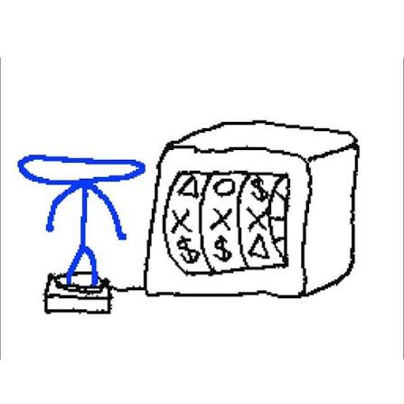

# Agenda de Contatos

Software criado em **Java** para o controle e organização de contatos, estruturado de forma evolutiva ao longo das atividades da matéria de **Programação Orientada a Objetos (POO)**. O repositório reflete o amadurecimento gradual das técnicas de desenvolvimento, partindo do uso básico de variáveis e coleções até chegar à arquitetura em camadas, orientação a objetos, gravação em disco e interfaces visuais.

**Versão atual: V5.0.0 — Introdução ao Padrão MVC**

## Objetivo

Construir um sistema capaz de registrar, exibir, buscar, editar e remover contatos, colocando em prática, etapa por etapa, os fundamentos aprendidos durante o curso.

## Funcionalidades

- Cadastrar novos contatos.
- Exibir todos os registros salvos.
- Buscar contatos específicos.
- Editar dados existentes.
- Remover contatos da lista.
- Exportar registros para um arquivo de texto (TXT).
- Carregar os dados salvos de forma automática na abertura do programa.
- Exibir detalhes sobre o sistema.

Cada registro conta com os seguintes campos:
- Nome
- Celular
- E-mail

## Tecnologias utilizadas

- Java
- Programação Orientada a Objetos (POO)
- Collections Framework (`List` e `ArrayList`)
- Leitura e escrita em arquivos TXT
- Tratamento de exceções
- Padrão DAO (Data Access Object)
- Padrão MVC (Model-View-Controller)
- Git e GitHub

## Estrutura do projeto

```text
AgendaContatos/
├── src/
│   └── br/
│       └── edu/
│           ├── principal/
│           │   └── Principal.java
│           ├── modelo/
│           │   └── Contato.java
│           ├── visao/
│           │   └── AgendaView.java
│           ├── controle/
│           │   └── AgendaController.java
│           ├── dao/
│           │   └── ContatoDAO.java
│           └── uteis/
│               └── Uteis.java
├── contatos.txt
└── README.md
```

O documento `contatos.txt` serve como base de armazenamento e é gerado automaticamente no momento em que os dados são salvos pela primeira vez, caso não exista no diretório.

## Organização das classes

| Classe | Responsabilidade |
|---|---|
| `Principal` | Instanciar os objetos necessários e orquestrar o fluxo inicial do sistema. |
| `Contato` | Modelar a estrutura e os atributos de um contato (Model). |
| `AgendaView` | Capturar as entradas do usuário e exibir as saídas no console (View). |
| `AgendaController` | Gerenciar a lógica e o fluxo das ações do CRUD (Controller). |
| `ContatoDAO` | Executar a leitura e a escrita dos registros no arquivo de texto (DAO). |
| `Uteis` | Fornecer métodos de apoio e utilidades gerais para o sistema. |

## V5.0.0 — Introdução ao Padrão MVC

Nesta atualização, adotamos a arquitetura **MVC (Model-View-Controller)**, elevando a qualidade da estrutura do código ao isolar a interface com o usuário, o controle de fluxo e o gerenciamento dos dados.

Na versão anterior (V4.1.0), o padrão DAO já isolava a gravação em arquivo das regras de negócio, mas a classe `Agenda` acumulava tanto o diálogo com o usuário quanto o processamento das ações. Com a nova abordagem, dividimos essas tarefas entre as camadas do MVC, preservando todos os recursos anteriores e o armazenamento em TXT.

### Principais alterações

- Criação do pacote `br.edu.visao` contendo a classe `AgendaView`.
- Criação do pacote `br.edu.controle` contendo a classe `AgendaController`.
- Isolamento entre a captura de dados, o processamento lógico e a exibição de mensagens.
- Refatoração das rotinas de cadastro, listagem, busca, edição e remoção.
- Reaproveitamento das funções de busca dentro dos fluxos de edição e exclusão.
- Conexão entre as camadas do MVC na classe `Principal`.
- Exclusão da antiga classe `Agenda` após transferir seus métodos para os novos componentes.
- Continuidade do mecanismo de salvamento em arquivo via padrão DAO.
- Manutenção do funcionamento via linha de comando (terminal).

### Organização MVC

A arquitetura MVC segmenta o software em três núcleos distintos:

| Componente | Responsabilidade | Implementação |
|---|---|---|
| **Model** | Estruturar e tratar os dados do domínio. | `Contato` e persistência via `ContatoDAO`. |
| **View** | Interagir com o usuário (entrada e saída). | `AgendaView` |
| **Controller** | Intermediar e gerenciar as ações requisitadas. | `AgendaController` |

A camada DAO segue encarregada de gravar e ler os dados no disco, trabalhando em conjunto com a estrutura MVC.

### Exemplo de utilização

A classe `Principal` prepara e interliga os objetos essenciais para rodar o sistema:

```java
List<Contato> contatos = new ArrayList<>();
ContatoDAO dao = new ContatoDAO("contatos.txt");
dao.carregarContatos(contatos);

Scanner sc = new Scanner(System.in);
AgendaView view = new AgendaView(sc);
AgendaController controller = new AgendaController(contatos, dao);
```

O cadastro de um novo registro passa a seguir este fluxo:

```java
Contato contato = view.lerContato();
controller.adicionarContato(contato);
view.mostrarMensagem("Contato adicionado com sucesso!");
```

Nesse cenário, a `View` coleta os dados informados no terminal, enquanto o `Controller` se encarrega de inseri-los na lista em memória.

Para exibir os registros, o `Controller` recupera a coleção e a `View` cuida da formatação na tela:

```java
List<Contato> lista = controller.listarContatos();
view.mostrarContatos(lista);
```

Isso garante que a camada visual fique completamente desacoplada das regras de manipulação dos dados.

### Persistência dos dados

O armazenamento em disco segue sob responsabilidade da classe `ContatoDAO`, que grava as informações no arquivo `contatos.txt` separando os campos por ponto e vírgula (`;`).

Exemplo de conteúdo do arquivo:

```text
Maria;85999999999;maria@email.com
João;85988888888;joao@email.com
```

Na inicialização, os registros existentes no arquivo são transferidos para a lista em memória. Quando o usuário escolhe encerrar o programa, o `Controller` aciona o `DAO` para gravar as alterações:

```java
boolean salvou = controller.salvarContatos();
```

Se houver alguma falha no processo de escrita, o sistema alerta o usuário e continua aberto para evitar perda de informações.

## Histórico de versões

| Versão | Descrição |
|---|---|
| **V0.0.0** | Primeiros passos com variáveis e registro de um único contato. |
| **V0.1.0** | Adoção de vetores (arrays) para guardar múltiplos contatos. |
| **V0.2.0** | Migração para coleções dinâmicas com `List` e `ArrayList`. |
| **V0.3.0** | Desenvolvimento das rotinas completas de CRUD. |
| **V1.0.0** | Divisão do código em métodos específicos para cada tarefa. |
| **V1.1.0** | Agrupamento dos métodos em classes distintas. |
| **V1.1.1** | Ajuste de bug na rotina de encerramento do sistema. |
| **V2.0.0** | Primeiros testes com leitura e escrita de arquivos. |
| **V2.1.0** | Gravação definitiva dos contatos em arquivo TXT. |
| **V3.0.0** | Aplicação prática de classes e instâncias de objetos. |
| **V3.1.0** | Tipagem da lista utilizando `ArrayList<Contato>`. |
| **V3.2.0** | Adaptação do CRUD para manipular objetos `Contato`. |
| **V3.3.0** | Aplicação de encapsulamento e melhorias na classe `Contato`. |
| **V4.0.0** | Adoção do padrão DAO e divisão do projeto em pacotes. |
| **V4.1.0** | Refatoração do DAO para orientação a objetos com construtor e métodos de instância. |
| **V5.0.0** | Implementação da arquitetura MVC dividindo Model, View e Controller. |

## Conceitos trabalhados na V5.0.0

- Arquitetura de software MVC.
- Divisão clara de responsabilidades.
- Estruturação do sistema em camadas.
- Modelagem com classes e objetos.
- Encapsulamento de atributos.
- Uso de construtores.
- Injeção de dependências via construtor.
- Passagem e compartilhamento de referências em memória.
- Métodos com retorno de objetos e listas.
- Reaproveitamento de código.
- Refatoração estrutural.
- Integração entre os padrões MVC e DAO.
- Gravação de estado de objetos em arquivos de texto.

## Execução

Siga os passos abaixo para rodar o projeto localmente:

1. Certifique-se de ter o **Java JDK** instalado na máquina.
2. Importe o projeto em uma IDE de sua preferência (como Eclipse, IntelliJ ou VS Code).
3. Navegue até a classe `Principal`, situada no pacote `br.edu.principal`.
4. Inicie a aplicação executando o método `main()`.
5. Interaja com o sistema através das opções exibidas no console.

Caso o arquivo `contatos.txt` já exista na pasta do projeto, os dados serão importados automaticamente na abertura.

## Próxima versão

**V5.1.0 — MVC Completo**

Na atualização seguinte, o foco será refinar a arquitetura MVC, enxugando as tarefas que ainda residem na classe `Principal` e migrando as interações de console restantes da classe `Uteis` para dentro da `View`. A meta é consolidar o desacoplamento entre as camadas, tornar a inicialização mais limpa e deixar a base pronta para receber interfaces gráficas no futuro.


#### let's go gambling!




-> "Oh dang it!"